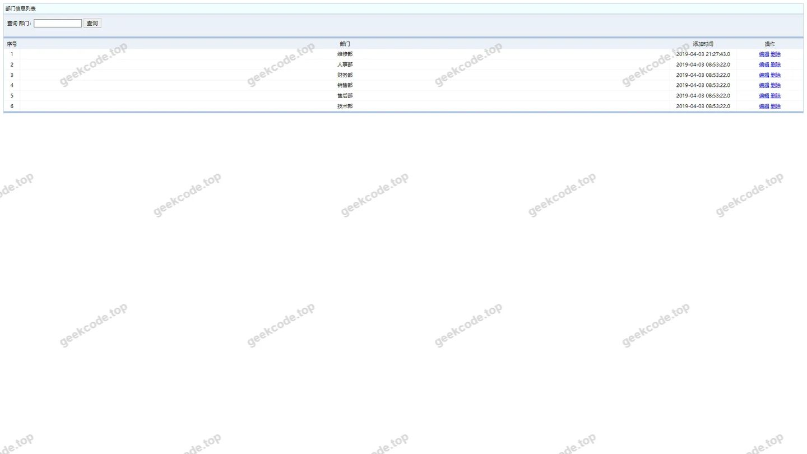
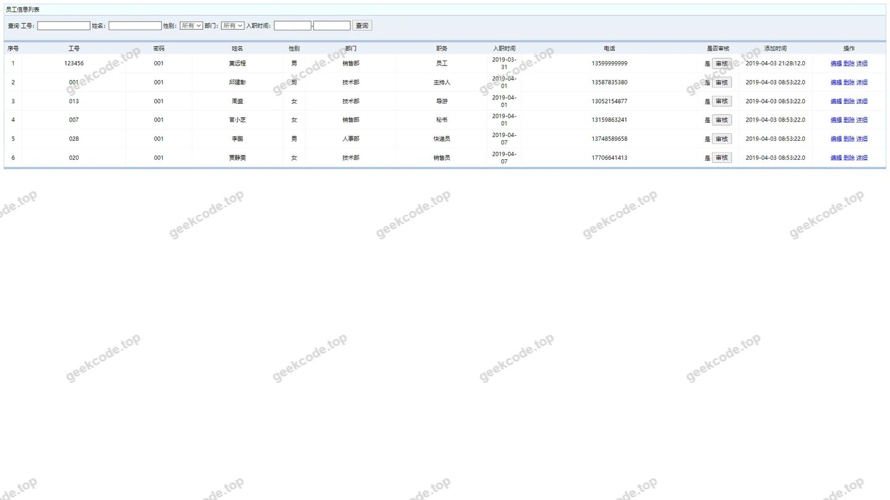
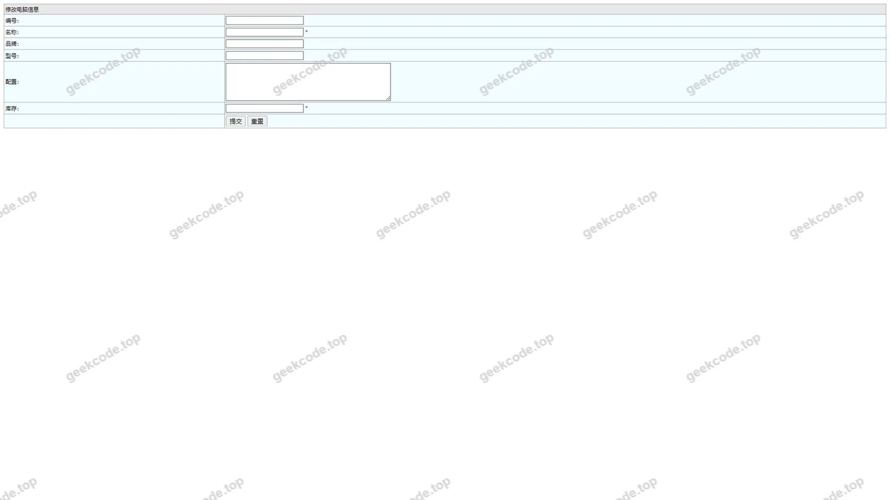
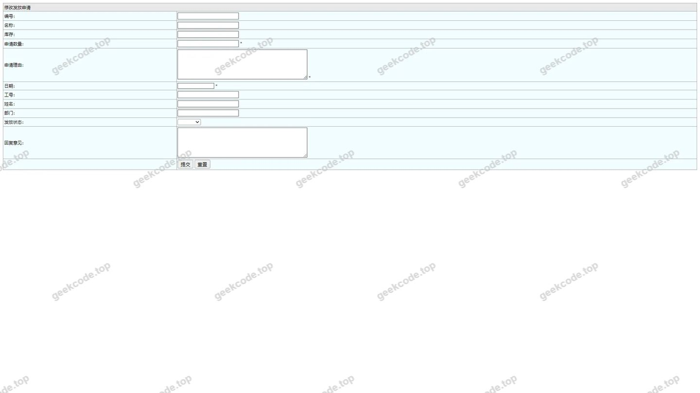
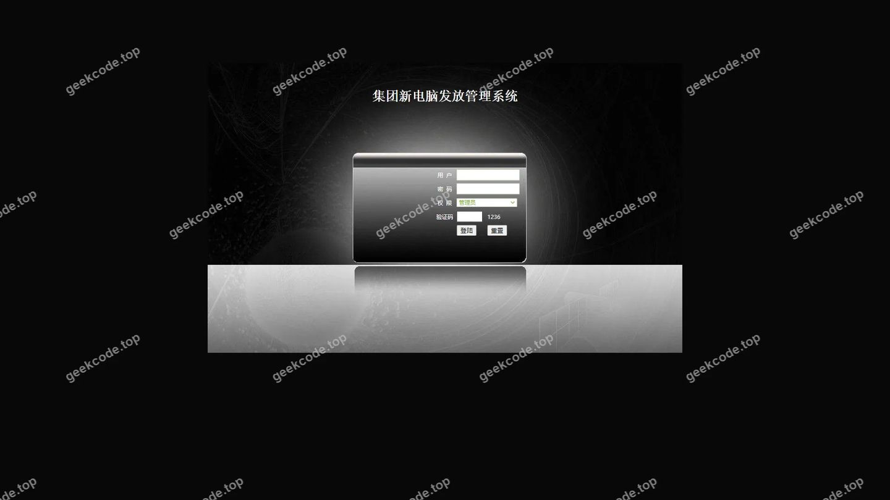
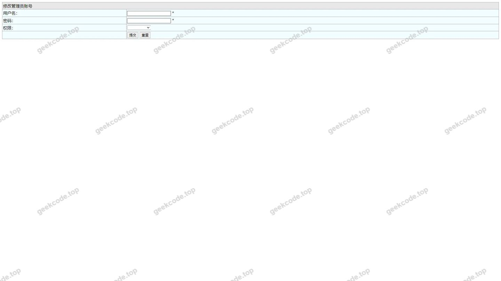
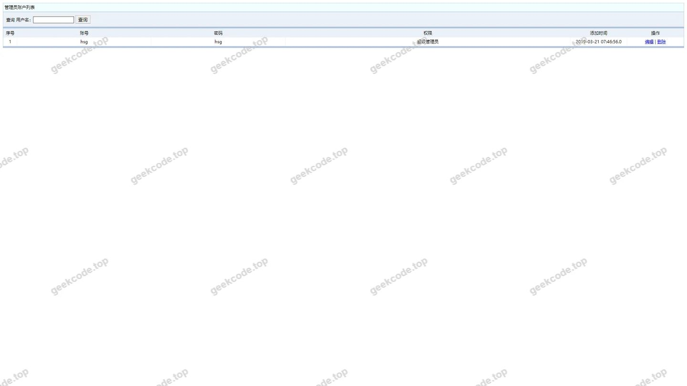

# ssm集团新电脑发放管理系统hsg5320B7程序

> 🎓 **计算机毕业设计 · ssm集团新电脑发放管理系统hsg5320B7程序**
>
> 本仓库只放**项目介绍 + 运行截图**（截图是站点带水印的原图，存在仓库 `images/` 里）。
>
> 👉 **完整可运行源码 / 数据库脚本 / 部署文档：[点我获取](https://geekcode.top/archives/ssm%E9%9B%86%E5%9B%A2%E6%96%B0%E7%94%B5%E8%84%91%E5%8F%91%E6%94%BE%E7%AE%A1%E7%90%86%E7%B3%BB%E7%BB%9Fhsg5320B7%E7%A8%8B%E5%BA%8F?utm_source=github)**
>
> 💬 咨询微信：**ir9372**　|　🌐 更多项目：[极客代码 geekcode.top](https://geekcode.top/?utm_source=github)
>
> 📌 项目详情页：<https://geekcode.top/archives/ssm%E9%9B%86%E5%9B%A2%E6%96%B0%E7%94%B5%E8%84%91%E5%8F%91%E6%94%BE%E7%AE%A1%E7%90%86%E7%B3%BB%E7%BB%9Fhsg5320B7%E7%A8%8B%E5%BA%8F?utm_source=github>

<table><td width="230" align="center"> <b>扫码加微信 ir9372</b></td><td valign="middle">📦 源码 = 项目介绍 + 全部运行截图 + 数据库 + 部署文档 👉 点上方任意截图，直接跳到 <b>极客代码 geekcode.top</b> 详情页</td></table>

---

<h1>ssm集团新电脑发放管理系统hsg5320B7程序</h1>
<h2>项目概述</h2>

本项目名为“ssm集团新电脑发放管理系统”，旨在解决企业内部员工电脑资产分配与管理的数字化需求。系统采用经典的SSM（Spring + Spring MVC + MyBatis）框架结合JSP技术构建，主要服务于企业行政或IT管理部门。核心功能涵盖用户管理、部门信息管理、员工信息维护、电脑设备信息登记以及电脑发放申请流程的处理。通过该系统，管理员可以实现对集团内部电脑资源的统一调配与记录，确保资产流向清晰可查。适用人群主要为负责企业固定资产管理及新员工入职设备发放的后台管理人员。

<h2>技术架构</h2>

本项目基于Java EE标准开发，后端采用SSM整合框架，前端使用JSP页面进行动态渲染。

<strong>1. 后端架构：</strong>

<ul>
<li><strong>Spring</strong>: 作为核心容器，负责Bean的管理、依赖注入及事务控制。</li>
<li><strong>Spring MVC</strong>: 处理HTTP请求，实现控制器（Controller）层逻辑，负责路由分发与视图解析。</li>
<li><strong>MyBatis</strong>: 持久层框架，通过XML映射文件或注解将SQL语句与Java对象绑定，简化数据库操作。</li>
</ul>

<strong>2. 前端架构：</strong>

<ul>
<li><strong>JSP (JavaServer Pages)</strong>: 服务器端脚本技术，用于生成动态HTML页面。页面中嵌入Java代码片段以展示从后端获取的数据列表及表单内容。</li>
</ul>

<strong>3. 数据交互流程：</strong>
浏览器发起请求 -&gt; DispatcherServlet拦截 -&gt; Controller处理业务逻辑 -&gt; Service层调用DAO -&gt; MyBatis执行SQL -&gt; 数据库返回结果 -&gt; Model封装数据 -&gt; JSP视图渲染 -&gt; 响应返回浏览器。

<h2>功能模块</h2>

根据提供的截图列表与项目类型，系统主要包含以下功能模块，均属于后台管理范畴：

<strong>1. 系统登录模块</strong>

<ul>
<li>提供管理员身份验证入口，确保只有授权人员方可访问系统内部数据。</li>
</ul>

<strong>2. 用户管理模块 (allusers)</strong>

<ul>
<li><strong>用户列表查看</strong>：展示系统中所有注册用户的详细信息。</li>
<li><strong>用户编辑/更新</strong>：允许管理员修改用户的基本资料或权限状态。</li>
</ul>

<strong>3. 部门信息管理模块 (bumenxinxi)</strong>

<ul>
<li><strong>部门列表查看</strong>：展示企业内部的组织架构及部门名称。</li>
<li><strong>部门信息编辑</strong>：支持对部门名称、描述等属性进行修改与维护。</li>
</ul>

<strong>4. 员工信息管理模块 (yuangongxinxi)</strong>

<ul>
<li><strong>员工列表查看</strong>：展示员工的个人基本信息及其所属部门关联关系。</li>
<li><strong>员工信息维护</strong>：支持新增、修改或删除员工档案数据。</li>
</ul>

<strong>5. 电脑设备管理模块 (diannaoxinxi)</strong>

<ul>
<li><strong>设备信息编辑</strong>：针对单台电脑设备的配置信息（如型号、序列号、状态等）进行录入或更新。</li>
</ul>

<strong>6. 发放申请管理模块 (fafangshenqing)</strong>

<ul>
<li><strong>申请记录编辑</strong>：处理电脑发放申请的审批流程，包括修改申请状态、备注信息等。</li>
</ul>
<h2>用户角色与权限</h2>

由于项目类型为纯后台管理系统且无前台导航菜单，系统主要面向单一的管理员角色。

<strong>1. 系统管理员 (Admin)</strong>

<ul>
<li><strong>权限范围</strong>：拥有系统的最高操作权限。</li>
<li><strong>可访问功能</strong>：</li>
<li>登录系统后台。</li>
<li>查看所有用户、部门、员工、电脑设备及发放申请的列表数据。</li>
<li>执行数据的增删改操作，具体包括：编辑用户信息、更新部门信息、维护员工档案、修改电脑设备详情、审核及更新发放申请状态。</li>
<li>通过“页面-编辑”界面对各实体数据进行具体的字段级修改。</li>
</ul>

<em>(注：根据现有截图与上下文，未体现普通员工或其他角色的独立登录入口或受限视图，故仅定义管理员角色。)</em>

<h2>项目特色与创新点</h2>

<strong>1. 流程闭环管理</strong>
系统将静态的基础数据（部门、员工、设备）与动态的业务流程（发放申请）相结合，实现了从“谁申请”、“什么设备”到“哪个部门”的全链路数据关联，避免了传统Excel管理中数据孤岛的问题。

<strong>2. 结构化数据存储</strong>
通过独立的模块化管理（用户、部门、员工、设备分离），保证了数据的一致性与完整性。例如，员工信息与部门信息的解耦设计，便于组织架构调整时的快速批量更新。

<strong>3. 轻量级高效部署</strong>
采用成熟的SSM+JSP技术栈，无需复杂的前端构建工具链，适合中小型企业的内网环境快速部署与维护，降低了系统的运维成本和技术门槛。

<h2>部署环境</h2>

为确保系统正常运行，需准备以下软件及硬件环境：

<strong>1. 操作系统</strong>

<ul>
<li>Windows Server / Linux (CentOS/Ubuntu) / macOS</li>
</ul>

<strong>2. Java运行环境</strong>

<ul>
<li>JDK 1.8 或更高版本（推荐JDK 1.8，兼容性好）</li>
</ul>

<strong>3. Web服务器</strong>

<ul>
<li>Apache Tomcat 8.5 或 9.x 版本</li>
</ul>

<strong>4. 数据库</strong>

<ul>
<li>MySQL 5.7 或 8.0 版本</li>
<li>需安装MySQL客户端工具（如Navicat或MySQL Workbench）用于导入初始化SQL脚本</li>
</ul>

<strong>5. 开发工具（可选，用于二次开发）</strong>

<ul>
<li>IntelliJ IDEA 或 Eclipse</li>
<li>Maven 3.6+ （用于项目依赖管理与打包）</li>
</ul>
<h2>五、技术特性</h2>
<ul>
<li>服务端模板渲染（JSP）</li>
</ul>
<h2>六、功能模块截图</h2>
<h3>前台用户端</h3>
<h4>页面-bumenxinxi列表</h4>

<h4>页面-yuangongxinxi列表</h4>

<h4>页面-bumenxinxiupdt</h4>

<h4>页面-diannaoxinxiupdt</h4>

<h4>页面-fafangshenqingupdt</h4>

<h3>后台管理端</h3>
<h4>页面-编辑</h4>

<h4>登录页</h4>

<h4>页面-allusersupdt</h4>

<h4>页面-allusers列表</h4>

---

## 获取完整源码

| 项目 | 说明 |
| --- | --- |
| 项目名 | ssm集团新电脑发放管理系统hsg5320B7程序 |
| 运行截图 | 本文 9 张（站点带水印原图，仓库 `images/` 目录） |
| 完整源码 | [https://geekcode.top/archives/ssm%E9%9B%86%E5%9B%A2%E6%96%B0%E7%94%B5%E8%84%91%E5%8F%91%E6%94%BE%E7%AE%A1%E7%90%86%E7%B3%BB%E7%BB%9Fhsg5320B7%E7%A8%8B%E5%BA%8F?utm_source=github](https://geekcode.top/archives/ssm%E9%9B%86%E5%9B%A2%E6%96%B0%E7%94%B5%E8%84%91%E5%8F%91%E6%94%BE%E7%AE%A1%E7%90%86%E7%B3%BB%E7%BB%9Fhsg5320B7%E7%A8%8B%E5%BA%8F?utm_source=github) |
| 咨询微信 | **ir9372**（备注：jingpin-yuanma） |
| 更多项目 | [极客代码 geekcode.top](https://geekcode.top/?utm_source=github) |

> 需要源码、部署、改配置、跑不起来等问题，加微信 ir9372 沟通，说明项目名即可。
